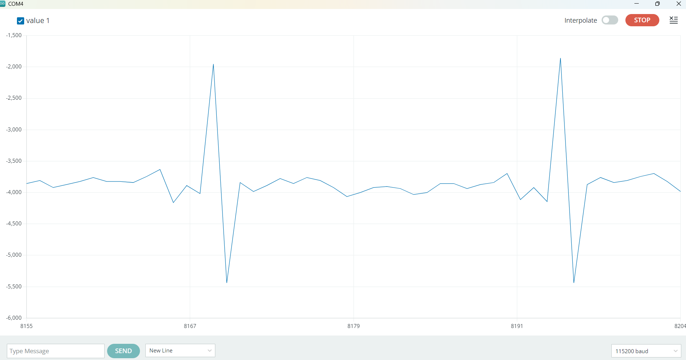
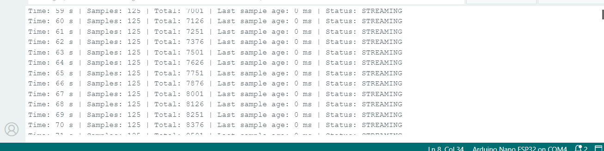
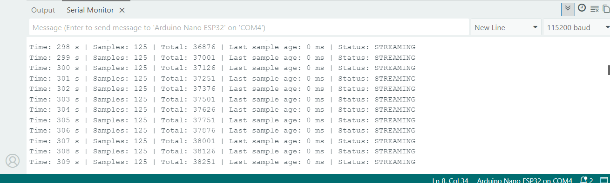
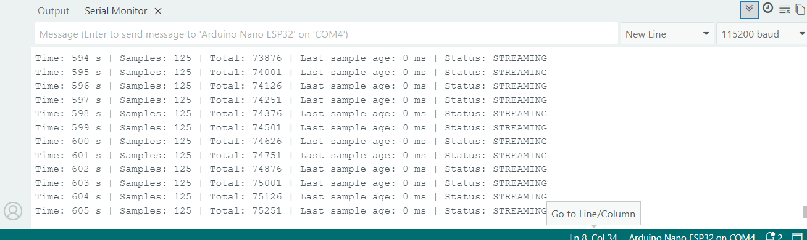

# Phase 7: Signal Reliability and Safety Validation

## Objective

The objective of Phase 7 is to evaluate ECG sample continuity, stationary
heart-rate reliability, electrode-disconnection behavior, signal
recovery, and motion-related interference.

This phase will also develop signal-quality protection so unreliable ECG
measurements cannot activate future heart-rate-zone audio prompts.

## Test Progress

- [x] Test 1: Stationary raw ECG baseline
- [x] Test 2: Ten-minute raw-sample continuity
- [ ] Test 3: Ten-minute stationary BPM reliability
- [ ] Test 4: Electrode disconnection and recovery
- [ ] Test 5: Implement signal-quality protection
- [ ] Test 6: Verify signal-quality protection
- [ ] Test 7: Controlled movement testing
- [ ] Test 8: Final endurance test

## Test 1: Stationary Raw ECG Baseline

### Objective

The objective was to confirm that the new electrode pads could produce a
repeatable raw ECG waveform while the user remained seated and still.

### Test Configuration

- Microcontroller: Arduino Nano ESP32
- ECG sensor: ProtoCentral MAX30003
- Electrodes: Three new disposable ECG electrode pads
- Serial speed: 115200 baud
- Test condition: Seated and stationary
- Electrode leads connected: Red, yellow, and green

The MAX30003 continued to be checked approximately every 8 milliseconds.
For easier visualization, the sketch averaged four raw samples into each
point sent to Arduino Serial Plotter.

### Procedure

1. All three new electrode pads were attached.
2. The red, yellow, and green cable snaps were connected.
3. Arduino Serial Plotter was opened at 115200 baud.
4. The signal was allowed to settle.
5. The stationary waveform was observed for approximately two minutes.

### Result

A repeating raw ECG waveform was visible with all three electrodes
connected. The slower plotted output made the waveform easier to inspect.

This test confirmed basic raw ECG acquisition under stationary
conditions. It did not evaluate medical accuracy or signal behavior
during movement.

### Evidence

## Test 2: Ten-Minute Raw-Sample Continuity

### Objective

The objective was to determine whether the Arduino Nano ESP32 could
continuously receive raw ECG samples from the MAX30003 for ten minutes
without a sampling interruption, sensor-communication failure, or
unexpected restart.

### Test Configuration

- Microcontroller: Arduino Nano ESP32
- ECG sensor: ProtoCentral MAX30003
- MAX30003 chip-select pin: D10
- Serial speed: 115200 baud
- Expected sample rate: Approximately 125 samples per second
- Electrode condition: All three electrodes connected
- Test condition: Seated and stationary
- Test duration: 10 minutes

### Method

A dedicated continuity-test sketch counted every raw ECG sample received
from the MAX30003. Once per second, the program reported:

- Samples received during the reporting period
- Cumulative sample count
- Age of the newest sample
- Current streaming status

Evidence was recorded at approximately 60, 300, and 600 seconds.

### Results

| Checkpoint | Samples per second | Total samples | Last-sample age | Status |
|---:|---:|---:|---:|---|
| 1 minute — 60 seconds | 125 | 7,126 | 0 ms | STREAMING |
| 5 minutes — 300 seconds | 125 | 37,126 | 0 ms | STREAMING |
| 10 minutes — 600 seconds | 125 | 74,626 | 0 ms | STREAMING |

Between the one-minute and five-minute checkpoints, 30,000 additional
samples were received over 240 seconds. This corresponds to exactly 125
samples per second.

Between the five-minute and ten-minute checkpoints, 37,500 additional
samples were received over 300 seconds. This also corresponds to exactly
125 samples per second.

The cumulative sample count increased consistently, the last-sample age
remained at 0 ms, and the status remained `STREAMING` at every documented
checkpoint.

### Result

The prototype successfully completed the ten-minute raw-sample
continuity test. No MAX30003 sampling dropout, `NO SAMPLES` condition, or
unexpected restart was observed during the documented run.

The test confirms reliable short-term transfer of raw ECG samples from
the MAX30003 to the Nano ESP32 under stationary conditions. It does not
establish the physiological accuracy of the ECG or heart-rate estimate.

### Evidence

#### One-minute checkpoint

The system was receiving 125 samples per second with a last-sample age of
0 ms and a status of `STREAMING`.

#### Five-minute checkpoint

The cumulative count reached 37,126 samples while acquisition remained
continuous.

#### Ten-minute checkpoint

The system reached the ten-minute checkpoint with 74,626 cumulative
samples, a last-sample age of 0 ms, and a status of `STREAMING`.

### Conclusion

Test 2 passed. The MAX30003 and Nano ESP32 maintained continuous raw ECG
sample acquisition at approximately 125 samples per second for the full
ten-minute documented period.

