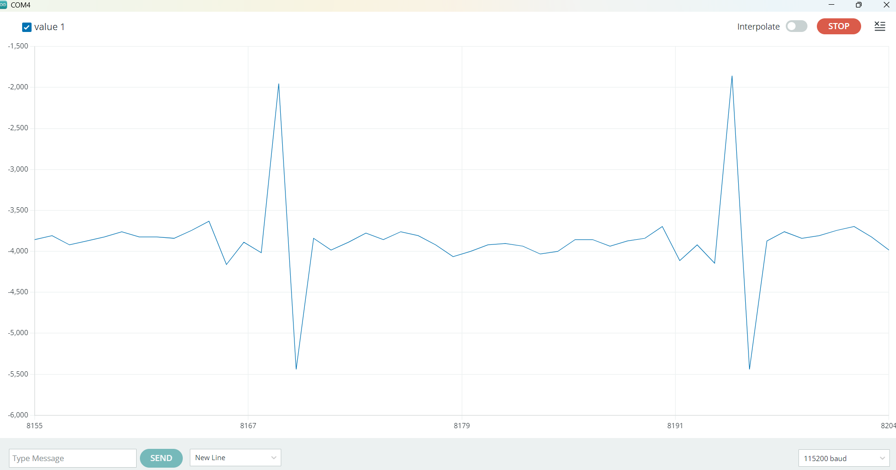
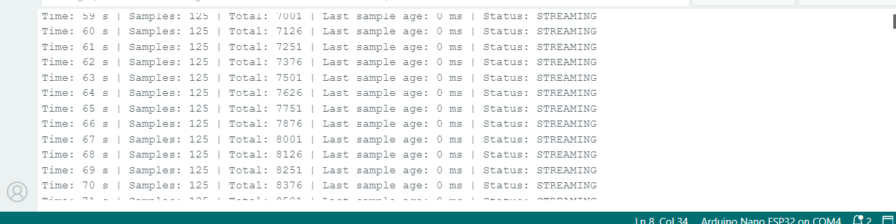
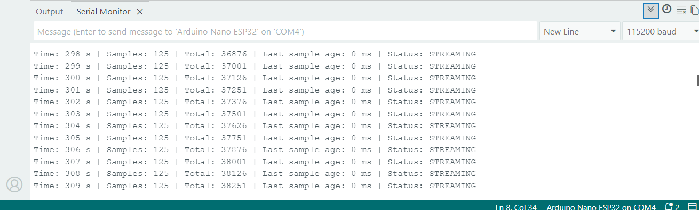
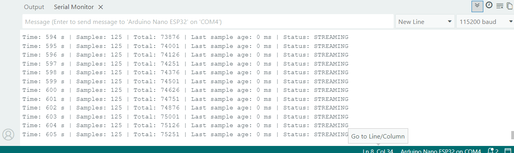

# Phase 7: Signal Reliability and Safety Validation

## Objective

The objective of Phase 7 is to evaluate ECG sample continuity, stationary
heart-rate reliability, electrode-disconnection behavior, signal
recovery, and motion-related interference.

This phase will also develop signal-quality protection so unreliable ECG
measurements cannot activate future heart-rate-zone audio prompts.

## Test Progress

## Phase 7 Test Checklist

- [x] Test 1: Record stationary raw ECG waveform
- [x] Test 2: Complete ten-minute raw-sample continuity test
- [x] Test 3: Complete ten-minute stationary BPM and OLED reliability test
- [x] Test 4: Test electrode disconnection and recovery
- [x] Test 5: Implement signal-quality protection
- [x] Test 6: Verify signal-quality protection
- [ ] Test 7: Perform controlled movement testing
- [ ] Test 8: Complete final endurance test

## Test 1: Stationary Raw ECG Baseline

### Objective

The objective was to confirm that the new electrode pads could produce a
repeatable raw ECG waveform while the user remained seated and still.

### Test Configuration

- Microcontroller: Arduino Nano ESP32
- ECG sensor: ProtoCentral MAX30003
- Electrodes: Three new disposable ECG electrode pads
- Serial speed: 115200 baud
- Test condition: Seated and stationary
- Electrode leads connected: Red, yellow, and green

The MAX30003 continued to be checked approximately every 8 milliseconds.
For easier visualization, the sketch averaged four raw samples into each
point sent to Arduino Serial Plotter.

### Procedure

1. All three new electrode pads were attached.
2. The red, yellow, and green cable snaps were connected.
3. Arduino Serial Plotter was opened at 115200 baud.
4. The signal was allowed to settle.
5. The stationary waveform was observed for approximately two minutes.

### Result

A repeating raw ECG waveform was visible with all three electrodes
connected. The slower plotted output made the waveform easier to inspect.

This test confirmed basic raw ECG acquisition under stationary
conditions. It did not evaluate medical accuracy or signal behavior
during movement.

### Evidence

## Test 2: Ten-Minute Raw-Sample Continuity

### Objective

The objective was to determine whether the Arduino Nano ESP32 could
continuously receive raw ECG samples from the MAX30003 for ten minutes
without a sampling interruption, sensor-communication failure, or
unexpected restart.

### Test Configuration

- Microcontroller: Arduino Nano ESP32
- ECG sensor: ProtoCentral MAX30003
- MAX30003 chip-select pin: D10
- Serial speed: 115200 baud
- Expected sample rate: Approximately 125 samples per second
- Electrode condition: All three electrodes connected
- Test condition: Seated and stationary
- Test duration: 10 minutes

### Method

A dedicated continuity-test sketch counted every raw ECG sample received
from the MAX30003. Once per second, the program reported:

- Samples received during the reporting period
- Cumulative sample count
- Age of the newest sample
- Current streaming status

Evidence was recorded at approximately 60, 300, and 600 seconds.

### Results

| Checkpoint | Samples per second | Total samples | Last-sample age | Status |
|---:|---:|---:|---:|---|
| 1 minute — 60 seconds | 125 | 7,126 | 0 ms | STREAMING |
| 5 minutes — 300 seconds | 125 | 37,126 | 0 ms | STREAMING |
| 10 minutes — 600 seconds | 125 | 74,626 | 0 ms | STREAMING |

Between the one-minute and five-minute checkpoints, 30,000 additional
samples were received over 240 seconds. This corresponds to exactly 125
samples per second.

Between the five-minute and ten-minute checkpoints, 37,500 additional
samples were received over 300 seconds. This also corresponds to exactly
125 samples per second.

The cumulative sample count increased consistently, the last-sample age
remained at 0 ms, and the status remained `STREAMING` at every documented
checkpoint.

### Result

The prototype successfully completed the ten-minute raw-sample
continuity test. No MAX30003 sampling dropout, `NO SAMPLES` condition, or
unexpected restart was observed during the documented run.

The test confirms reliable short-term transfer of raw ECG samples from
the MAX30003 to the Nano ESP32 under stationary conditions. It does not
establish the physiological accuracy of the ECG or heart-rate estimate.

### Evidence

#### One-minute checkpoint

The system was receiving 125 samples per second with a last-sample age of
0 ms and a status of `STREAMING`.

#### Five-minute checkpoint

The cumulative count reached 37,126 samples while acquisition remained
continuous.

#### Ten-minute checkpoint

The system reached the ten-minute checkpoint with 74,626 cumulative
samples, a last-sample age of 0 ms, and a status of `STREAMING`.

### Conclusion

Test 2 passed. The MAX30003 and Nano ESP32 maintained continuous raw ECG
sample acquisition at approximately 125 samples per second for the full
ten-minute documented period.

## Test 3: Ten-Minute Stationary BPM and OLED Reliability

### Objective

The objective was to determine whether continuous raw ECG acquisition
could produce stable BPM and R–R estimates for ten minutes while the
participant remained seated and stationary.

The test also checked whether the Serial Monitor and OLED continued
updating without freezing or unexpectedly restarting.

### Test Configuration

- Microcontroller: Arduino Nano ESP32
- ECG sensor: ProtoCentral MAX30003
- Display: 128 × 64 OLED at I2C address `0x3D`
- OLED pins: A2 for SDA and A3 for SCL
- MAX30003 chip-select pin: D10
- Serial speed: 115200 baud
- Electrode condition: All three electrodes connected
- Test condition: Seated and stationary
- Test duration: 10 minutes

### Method

The Phase 6 heart-rate and OLED sketch was copied into a separate Phase
7 test folder and uploaded to the Nano ESP32.

After all three electrodes were connected, the system was allowed to
acquire a plausible heart-rate estimate. The participant then remained
seated and stationary for ten minutes.

Serial Monitor evidence was recorded at approximately 1, 5, and 10
minutes. The output was checked for plausible BPM values, corresponding
R–R intervals, continued updates, signal-loss messages, freezes, and
unexpected restarts.

### Results

| Checkpoint | Visible BPM range | Visible R–R range | Last visible reading | Result |
|---:|---:|---:|---:|---|
| 1 minute | 79–86 BPM | 695–757 ms | 86 BPM / 695 ms | Stable |
| 5 minutes | 78–83 BPM | 718–765 ms | 78 BPM / 765 ms | Stable |
| 10 minutes | 71–82 BPM | 726–835 ms | 78 BPM / 765 ms | Stable |

All documented BPM and R–R pairs were internally consistent with the
approximate relationship:

\[
\text{BPM} \approx \frac{60{,}000}{\text{R–R interval in milliseconds}}
\]

For example, an R–R interval of 765 ms corresponds to approximately
78.4 BPM, which agrees with the displayed value of 78 BPM.

No extreme BPM spikes, `No plausible reading` messages, permanent
output freezes, or unexpected restarts were visible in the documented
checkpoints.

### Evidence

#### One-minute checkpoint

The one-minute checkpoint showed continuous readings between
approximately 79 and 86 BPM with corresponding R–R intervals.

#### Five-minute checkpoint

The five-minute checkpoint showed a stable group of readings between
approximately 78 and 83 BPM.

#### Ten-minute checkpoint

The ten-minute checkpoint confirmed that plausible BPM and R–R output
continued through the end of the test.

### Result

Test 3 passed under stationary conditions.

The MAX30003 continued producing plausible heart-rate estimates through
the ten-minute test, and the BPM and R–R values remained mathematically
consistent. The results support short-term stationary reliability but
do not establish medical accuracy or reliability during walking.

Movement reliability, electrode disconnection behavior, and false-reading
rejection will be evaluated separately in later Phase 7 tests.

The OLED continued updating throughout the test and did not remain
permanently frozen on a previous reading.

## Test 4: Electrode Disconnection and Recovery

### Objective

The objective was to characterize how the prototype responds when each
electrode lead is disconnected individually and when all three leads are
disconnected together.

The test evaluated:

- Whether the system recognized signal loss
- Whether disconnected leads produced false BPM estimates
- Whether the OLED and Serial Monitor continued updating
- How long reacquisition required after reconnection
- Whether the system recovered without a manual reset

This was a characterization test. It did not assume that plausible-looking
BPM values obtained with a disconnected electrode represented a valid
heart-rate measurement.

### Test Configuration

- Microcontroller: Arduino Nano ESP32
- ECG sensor: ProtoCentral MAX30003
- Display: 128 × 64 OLED at I2C address `0x3D`
- OLED pins: A2 for SDA and A3 for SCL
- MAX30003 chip-select pin: D10
- Serial speed: 115200 baud
- Tested sketch:
  `code/phase-7-stationary-bpm/phase-7-stationary-bpm.ino`
- Test condition: Seated and stationary
- Power condition: Laptop operating from battery power
- Audio module: Not active
- Number of trials: Two

### Method

Each trial began with all three electrodes attached. The system was
allowed to acquire stable BPM and R–R readings before disconnection
testing began.

The red, yellow, and green leads were then disconnected individually.
For each lead:

1. The other two leads remained attached.
2. Output behavior was observed while the lead remained disconnected.
3. BPM, R–R, acquiring messages, rejected readings, and artifacts were
   recorded.
4. The lead was reconnected.
5. The time required to return to stable output was recorded.

After the individual-lead tests, all three leads were disconnected
together for 60 seconds. All three were then reattached, and final
reacquisition time was recorded.

The Nano ESP32 was not intentionally reset between conditions.

## Trial 1

### Trial 1 Results

| Condition | Behavior while disconnected | Recovery after reconnection |
|---|---|---:|
| All three connected | Normal and stable BPM and R–R readings | N/A |
| Red disconnected | No visible interruption, pause, or acquiring period | Immediate; no measurable delay |
| Yellow disconnected | The system required approximately 50 seconds to produce readings. During the first five minutes, brief extreme readings or a single `No plausible reading` message appeared approximately every 30 seconds. The output appeared more stable after five minutes. | Approximately 38 seconds |
| Green disconnected | `No plausible reading` continued for approximately 4 minutes 20 seconds. Output briefly appeared stable around 4 minutes 40 seconds. Minutes 5–6 were highly unstable. During minutes 7–10, readings were mostly in the 70–80 BPM range but were interrupted approximately every 20 seconds by an extreme value or `No plausible reading`. | Approximately 20 seconds |
| All three disconnected | `No plausible reading` throughout the complete 60-second observation | Approximately 110 seconds |

### Trial 1 Observations

Disconnecting the red lead produced no obvious sustained effect.
Disconnecting the yellow lead produced temporary signal loss followed by
intermittent artifacts. Disconnecting the green lead caused the most
severe degradation and produced delayed periods of apparently normal
but intermittently unstable output.

Disconnecting all three leads caused the program to reject the signal for
the complete 60-second observation. After all three leads were
reattached, the system recovered without a reset, although reacquisition
required approximately 110 seconds.

## Trial 2

### Trial 2 Results

Initial acquisition with all three electrodes attached required
approximately three minutes. Once acquired, BPM and R–R readings remained
normal and stable for approximately three to four minutes.

| Condition | Behavior while disconnected | Recovery after reconnection |
|---|---|---:|
| All three connected | Stable BPM and R–R after approximately three minutes of initial acquisition | N/A |
| Red disconnected | Readings remained stable for three minutes, except for approximately three seconds of abnormal values immediately after disconnection | Effectively immediate; one abnormal low reading appeared for one second after reconnection |
| Yellow disconnected | At 10 seconds the program displayed `No plausible reading`. At 30 seconds it displayed 45 BPM/1328 ms; at 60 seconds, 84 BPM/710 ms; at two minutes, 80 BPM/750 ms; and at three minutes, 88 BPM/679 ms. | `No plausible reading` for approximately 30 seconds, followed by approximately 10 seconds of unreliable readings; reliable output returned after approximately 40 seconds |
| Green disconnected | `No plausible reading` continued for approximately 12 minutes. Scattered BPM estimates appeared during minutes 13–14. During minutes 14–16, readings appeared mostly stable around 75–85 BPM but were interrupted approximately every 20 seconds by an extreme value or `No plausible reading`. | Approximately 30 seconds |
| All three disconnected | `No plausible reading` throughout the complete 60-second observation | Approximately 105 seconds |

### Trial 2 Observations

Trial 2 reproduced the major behavior observed during Trial 1. Removing
red caused almost no sustained change. Removing yellow initially
disrupted acquisition but eventually produced plausible-looking BPM and
R–R values despite the lead remaining disconnected. Removing green
caused the longest and most severe degradation.

The apparently stable values produced with yellow or green disconnected
were not considered verified heart-rate measurements. Their occurrence
demonstrated that numerical plausibility and mathematical consistency
between BPM and R–R were not sufficient to establish signal quality.

The all-leads-off result closely reproduced Trial 1. The program rejected
the signal for the full 60 seconds, and final reacquisition required 105
seconds compared with 110 seconds during Trial 1.

## Comparison Between Trials

| Finding | Trial 1 | Trial 2 | Interpretation |
|---|---:|---:|---|
| Red disconnected | No sustained effect | Only brief transition artifacts | Red disconnection was not reliably identified |
| Yellow reconnected | 38-second recovery | Approximately 40-second recovery | Highly repeatable recovery behavior |
| Green disconnected | Delayed, intermittent false stability | Longer delay followed by intermittent false stability | Same failure pattern with variable timing |
| Green reconnected | 20-second recovery | 30-second recovery | Recovery occurred without a reset |
| All leads disconnected | No plausible reading for 60 seconds | No plausible reading for 60 seconds | Highly repeatable rejection behavior |
| All leads reconnected | 110-second recovery | 105-second recovery | Highly repeatable recovery time |

## Analysis

The two trials produced consistent qualitative results despite
differences in exact timing.

### Red-Lead Disconnection

Red-lead disconnection was not reliably identified. The system continued
producing stable-looking BPM and R–R output with almost no interruption.
This does not prove that the red lead was defective or unnecessary. It
only demonstrates that the current software continued producing
estimates using the remaining connections.

### Yellow-Lead Disconnection

Yellow-lead disconnection initially disrupted acquisition but later
produced plausible-looking BPM and R–R estimates.

For example, Trial 2 produced:

- 45 BPM with an R–R interval of 1328 ms
- 84 BPM with an R–R interval of 710 ms
- 80 BPM with an R–R interval of 750 ms
- 88 BPM with an R–R interval of 679 ms

These pairs were mathematically consistent, but they could not be
considered verified because the yellow lead remained disconnected. This
demonstrated that agreement between BPM and R–R does not independently
confirm ECG signal quality.

### Green-Lead Disconnection

Green-lead disconnection caused the strongest and longest degradation.
Both trials eventually produced periods of plausible-looking output, but
those periods continued to be interrupted by extreme or rejected
readings.

This behavior was classified as false or unverified stability. The large
difference between the two trials' timing also demonstrated that a fixed
waiting period cannot determine whether the signal has become reliable.

### All-Leads-Off Behavior

When all three leads were disconnected, the program displayed
`No plausible reading` throughout both 60-second observations. This was
the desired visible behavior.

After all three leads were reattached, reacquisition required 110 seconds
during Trial 1 and 105 seconds during Trial 2. The close agreement
demonstrated repeatable recovery behavior.

However, the existing sketch used broad BPM and R–R plausibility limits.
The test did not establish that the software positively detected physical
electrode disconnection.

## Test 4 Result

Test 4 successfully characterized electrode-disconnection and recovery
behavior across two trials.

The hardware remained operational and eventually recovered from every
tested condition without an intentional manual reset. However, the
software did not reliably identify individual lead loss and sometimes
accepted plausible-looking estimates while an electrode remained
disconnected.

The results demonstrate that:

- A plausible BPM value does not necessarily indicate a valid ECG signal.
- Brief connection changes can create extreme transient readings.
- Individual lead loss is not reliably detected by numerical limits alone.
- Fixed reacquisition delays cannot guarantee signal validity.
- Previous BPM values must be cleared when signal quality becomes uncertain.
- Audio prompts must remain disabled during poor signal and reacquisition.
- A sustained clean-signal period is required before BPM is accepted.

Signal-quality protection, transient rejection, and a controlled
reacquisition state will be implemented in Test 5.

This prototype is experimental and is not intended for medical use.

### Evidence Note

Test 4 was documented primarily through timed observations recorded in
the results tables. Screenshots were not required because each condition
required continuous monitoring and controlled electrode changes.

## Test 5: Signal-Quality Protection

### Objective

The objective was to implement a software signal-quality layer that
prevents questionable BPM estimates from being immediately accepted or
used by future audio-zone logic.

Test 4 demonstrated that plausible-looking BPM and R–R values could
occasionally appear while an electrode was disconnected. Test 5
therefore added explicit signal states, transient rejection, filtering,
and a controlled reacquisition period.

### Library Configuration

- Library: ProtoCentral MAX30003 ECG AFE Sensor Library
- Installed version: 2.0.0
- Update available during testing: No
- Available examples:
  - `01-ecg-openview`
  - `02-ecg-plotter`
  - `03-hr-rtor`

The installed library did not include a lead-off example. Test 5
therefore implemented a software quality guard using the existing
heart-rate and R–R functions.

### Tested Sketch

The tested sketch is available at:

[`code/phase-7-signal-quality/phase-7-signal-quality.ino`](../code/phase-7-signal-quality/phase-7-signal-quality.ino)

### Implemented Protections

The Test 5 sketch added three signal states:

| State | Meaning | OLED behavior | BPM accepted? |
|---|---|---|:---:|
| `ACQUIRING` | Waiting for a sustained period of acceptable input | Displays `Acquiring...` and the stability counter | No |
| `VALID` | Input passed the available checks and qualification period | Displays filtered BPM and R–R | Yes |
| `POOR_SIGNAL` | An invalid or questionable result was detected | Clears BPM and displays `POOR SIGNAL` | No |

The sketch also added:

- Broad BPM and R–R plausibility limits
- A BPM/R–R mathematical consistency check
- Rejection of a one-second BPM change greater than 20 BPM
- Five-reading median filtering
- A 30-second clean-signal qualification period
- Immediate clearing of old BPM values after rejected input
- Automatic reset of the qualification timer
- Diagnostic Serial Monitor messages
- Suppression of future audio activity outside the `VALID` state

The 20 BPM jump limit and 30-second qualification period are experimental
engineering settings, not medical thresholds.

### Method

The protected sketch was first tested with all electrodes disconnected
from the body. The system was observed for one minute to determine
whether it would incorrectly accept a disconnected signal.

All three electrodes were then attached. The time to the first
`ACQUIRING` message and the time to `VALID` were recorded.

After validation, the system was observed for approximately seven
minutes while the participant remained seated and stationary.

### Results

| Observation | Result |
|---|---|
| Disconnected state | `POOR_SIGNAL` |
| Incorrectly reached `VALID` while disconnected? | No |
| Time from connecting electrodes to first `ACQUIRING` message | Approximately 5 seconds |
| Did the qualification period complete? | Yes; the final visible acquiring count was 29/30, followed by `VALID` |
| Time from connecting electrodes to `VALID` | Approximately 54 seconds |
| Raw BPM at initial validation | 87 BPM |
| Filtered BPM after validation | 86 BPM |
| Filtered R–R after validation | 695 ms |
| Did the OLED display `Status: VALID`? | Yes |
| Later protection events | `POOR_SIGNAL` appeared at approximately 2 minutes and 2 minutes 20 seconds, resetting qualification twice |
| Longest continuous valid period | Approximately 4 minutes, from minute 3 through minute 7 |

The filtered result was internally consistent:

\[
60{,}000 \div 695 \approx 86.3\text{ BPM}
\]

This agrees with the displayed filtered value of approximately 86 BPM.

### Analysis

With all electrodes disconnected, the system remained in
`POOR_SIGNAL` and did not incorrectly enter `VALID`. This confirmed that
the protected sketch rejected the completely disconnected condition
during the initial test.

After all three electrodes were connected, the system entered
`ACQUIRING` after approximately five seconds and reached `VALID` after
approximately 54 seconds.

The final visible qualification count was 29/30 because the sketch
immediately changes to `VALID` when the thirtieth acceptable report is
received. It does not display a separate 30/30 acquiring screen.

Two later `POOR_SIGNAL` events occurred at approximately 2 minutes and
2 minutes 20 seconds. These events demonstrated that the protection
system cleared validation when it encountered questionable input.
Following those events, the system recovered automatically.

The system then remained continuously `VALID` from approximately minute
3 through minute 7.

### Limitations

The Test 5 protections are software-based. They improve transient
rejection and controlled reacquisition but do not prove physical
electrode attachment.

A sufficiently stable false signal may still pass the numerical and
timing checks. Red-lead disconnection was especially difficult to
identify during Test 4.

The sketch therefore cannot yet be considered a replacement for true
hardware lead-off detection. Individual electrode disconnections will be
retested with the protected sketch during Test 6.

### Result

Test 5 passed its implementation and initial stationary validation test.

The system:

- Rejected the completely disconnected condition
- Did not incorrectly enter `VALID` while completely disconnected
- Required sustained acceptable input before displaying BPM
- Applied median filtering
- Rejected questionable input
- Cleared validation after poor-signal events
- Recovered automatically without resetting the Nano
- Maintained approximately four continuous minutes of valid stationary
  operation

Audio output remained disabled during this test.

### Evidence Note

Test 5 was documented through the tested source code and timed
observations. No screenshots were retained. The absence of screenshots
does not affect the recorded functional results because the state
transitions, qualification timing, filtered output, and continuous-valid
period were documented during the test.

This prototype is experimental and is not intended for medical use.

## Test 6: Signal-Quality Protection Verification

### Objective

The objective was to verify the software signal-quality protections
implemented during Test 5.

The protected sketch was tested by disconnecting red, yellow, and green
individually and then disconnecting all three leads together. The test
evaluated whether the software:

- Entered `POOR_SIGNAL` when input became questionable
- Removed the displayed BPM
- Rejected brief artifacts
- Prevented disconnected conditions from reaching `VALID`
- Required a controlled reacquisition period
- Recovered automatically after reconnection
- Continued operating without a manual reset

### Test Configuration

- Microcontroller: Arduino Nano ESP32
- ECG sensor: ProtoCentral MAX30003
- Display: 128 × 64 OLED at I2C address `0x3D`
- OLED pins: A2 for SDA and A3 for SCL
- MAX30003 chip-select pin: D10
- Serial speed: 115200 baud
- Test condition: Seated and stationary
- Audio output: Disabled
- Laptop power: Battery operation during body-connected testing
- Signal qualification period: 30 consecutive seconds
- Median-filter size: Five readings
- Abrupt-change threshold: 20 BPM
- Hardware lead-off detection: Not enabled

### Tested Sketch

Test 6 reused the protected Test 5 sketch:

[`code/phase-7-signal-quality/phase-7-signal-quality.ino`](../code/phase-7-signal-quality/phase-7-signal-quality.ino)

No separate Test 6 sketch was required.

### Method

The system was first allowed to reach `VALID` with all three electrodes
connected.

The red, yellow, and green leads were then disconnected individually.
For each condition, the OLED and Serial Monitor states were observed,
including:

- `POOR_SIGNAL`
- `ACQUIRING`
- `VALID`
- Time required to return to `VALID`
- Whether `VALID` occurred while a lead remained disconnected
- Any freeze, restart, or prolonged instability

All three leads were also disconnected together for 60 seconds and then
reattached.

Because the original all-leads recovery test used old electrode pads and
produced prolonged instability, a stationary confirmation and targeted
all-leads recovery test were later performed with fresh pads.

### Combined Results

| Condition | Behavior while disconnected | Reached `VALID` while disconnected? | Recovery after reconnection | Result |
|---|---|:---:|---:|---|
| Red disconnected | A transient disturbance triggered `ACQUIRING`, but the system returned to `VALID` while red remained disconnected | Yes | Approximately 30 seconds | Transient rejection passed; persistent disconnection detection failed |
| Yellow disconnected | Initially remained in `ACQUIRING`, but later produced plausible `VALID` readings with yellow still disconnected; additional poor-signal events occurred | Yes | Approximately 1 minute 50 seconds | Transient rejection passed; persistent disconnection detection failed |
| Green disconnected | Alternated between `POOR_SIGNAL` and short acquiring attempts for ten minutes without reaching `VALID` | No during the ten-minute test | Approximately 1 minute 20 seconds | Passed the ten-minute green-disconnection test |
| All three disconnected | Immediately entered and remained in `POOR_SIGNAL` for the full 60-second observation | No | Original recovery was unstable; fresh-pad repeat reached `VALID` after approximately 2 minutes 10 seconds | Complete disconnection detection passed |
| Fresh-pad stationary baseline | All three connected | N/A | Reached `VALID` after approximately 3 minutes 30 seconds | Remained continuously valid for ten minutes |
| Fresh-pad all-leads repeat | `POOR_SIGNAL` for the full disconnected minute | No | Reached `VALID` approximately 2 minutes 10 seconds after reconnection | Stable overall, with one later brief interruption |

### Red-Lead Verification

#### Initial Attempt

During an initial red-lead attempt, reconnecting red caused the system to
enter `ACQUIRING` for approximately 30 seconds and then return to
`VALID`.

After remaining valid for almost one minute, both Serial Monitor and the
OLED stopped updating. This event was documented as a probable complete
processing or sensor-acquisition stall.

The red test was subsequently repeated.

#### Repeat Result

During the repeat:

1. Red was disconnected.
2. The system entered `ACQUIRING`.
3. It returned to `VALID` after approximately 30 seconds even though red
   remained disconnected.
4. Red remained disconnected for approximately three minutes.
5. Red was reconnected.
6. The system required another approximately 30-second acquiring period
   before returning to `VALID`.

During a six-minute post-reconnection observation, two additional
`POOR_SIGNAL` events occurred:

- Approximately one minute after reconnection
- Approximately four minutes after reconnection

Each event triggered approximately 30 seconds of reacquisition before
valid output returned.

The complete freeze observed during the first attempt was not reproduced
during the repeat.

#### Red-Lead Result

- Transient-artifact rejection: **Pass**
- Automatic recovery: **Pass**
- Persistent red-disconnection detection: **Fail**
- Complete freeze during the repeat: **No**

The protected sketch responded to transition artifacts but could not
confirm that red remained physically attached.

### Yellow-Lead Verification

Yellow remained disconnected for six minutes.

#### Disconnected Observations

| Time | State | Raw BPM | Filtered BPM | Filtered R–R |
|---:|---|---:|---:|---:|
| 0:00–1:15 | `ACQUIRING` | — | — | — |
| 1:30 | `VALID` | 76 | 82 | 726 ms |
| 2:00 | `VALID` | 81 | 80 | 750 ms |
| 3:00 | `VALID` | 79 | 79 | 757 ms |
| 3:30 | `POOR_SIGNAL`, followed by `ACQUIRING` | — | — | — |
| 4:00 | `VALID` | 78 | 78 | 765 ms |
| 4:30 | `POOR_SIGNAL`, followed by `ACQUIRING` | — | — | — |
| 5:00 | `VALID` | Approximately 83 | 82 | 726 ms |
| 5:00–6:00 | `VALID` | — | — | — |

A contemporaneous note appeared to show `803.0 BPM` at one checkpoint.
This was treated as a transcription or display-formatting error because
the protected sketch rejects raw BPM values above 220. The surrounding
filtered BPM and R–R values indicated a reading in approximately the low
80s.

#### Yellow Reconnection

Yellow was reconnected at the six-minute checkpoint.

The system returned to `VALID` at approximately 7 minutes 50 seconds,
representing a recovery time of approximately 1 minute 50 seconds.

At approximately 7 minutes 55 seconds, the following representative
values were observed:

- Raw BPM: 84
- Filtered BPM: Approximately 83
- Filtered R–R: 718 ms

The system remained continuously `VALID` through the nine-minute
checkpoint.

At nine minutes, it displayed:

- Raw BPM: 78
- Filtered BPM: 78
- Filtered R–R: 765 ms

#### Yellow-Lead Result

- Initial rejection after disconnection: **Pass**
- Transient-artifact rejection: **Pass**
- Automatic recovery: **Pass**
- Persistent yellow-disconnection detection: **Fail**
- Post-reconnection stability: **Pass**
- Complete freeze: **No**

The software detected several disturbances but ultimately accepted a
plausible-looking signal while yellow remained disconnected.

### Green-Lead Verification

Green was disconnected for ten minutes.

During the complete disconnected period, the system alternated between:

- `POOR_SIGNAL`
- Short `ACQUIRING` attempts lasting approximately 3–7 seconds

No acquiring attempt completed the required qualification period, and
the system never reached `VALID` during the ten-minute green-off test.

Green was reconnected at the ten-minute checkpoint. The system reached
`VALID` at approximately 11 minutes 20 seconds, representing a recovery
time of approximately 1 minute 20 seconds.

It then remained continuously valid through approximately 12 minutes
45 seconds, providing approximately 1 minute 25 seconds of uninterrupted
post-reconnection validation.

#### Green-Lead Result

- Ten-minute disconnection rejection: **Pass**
- Incorrectly reached `VALID` while disconnected: **No**
- Transient-artifact rejection: **Pass**
- Recovery after reconnection: **Pass**
- Short-term post-reconnection stability: **Pass**
- Complete freeze: **No**

This result establishes successful green-disconnection rejection for the
ten-minute observation. It does not establish that green disconnection
would be rejected indefinitely.

### Original All-Leads-Off Test

All three leads were disconnected together.

The system immediately entered `POOR_SIGNAL` and remained there for the
complete 60-second disconnected observation. It never reached `VALID`.

After all three leads were reattached:

1. The system alternated between `POOR_SIGNAL` and `ACQUIRING`.
2. It first reached `VALID` after approximately 5 minutes 30 seconds.
3. That valid period lasted approximately 1 minute 30 seconds.
4. It then remained continuously in `POOR_SIGNAL` for approximately four
   minutes.
5. It subsequently alternated between `POOR_SIGNAL`, `ACQUIRING`, and
   several short valid periods.
6. Later valid periods ranged from approximately 5 seconds to one minute.
7. The longest later valid period lasted approximately 4 minutes
   30 seconds.
8. A representative valid reading was approximately:
   - Raw BPM: 81
   - Filtered BPM: 81
   - Filtered R–R: 734 ms
9. The system eventually returned to `POOR_SIGNAL`, and the test was
   ended before another recovery completed.

The original recovery was classified as highly unstable. The electrode
pads used during this test were later identified as old.

### Fresh-Electrode Stationary Confirmation

The original electrode pads were replaced with fresh pads.

With all three electrodes connected:

1. The system remained in `POOR_SIGNAL` for approximately three minutes.
2. It then entered `ACQUIRING`.
3. It reached `VALID` at approximately 3 minutes 30 seconds.
4. It remained continuously `VALID` for the following ten minutes.

This result suggested that degraded electrode contact contributed
substantially to the instability observed during the original all-leads
recovery test.

### Fresh-Electrode All-Leads Recovery Repeat

A targeted all-leads disconnection and recovery sequence was repeated
using the fresh pads.

#### Baseline and Disconnection

1. The system remained continuously `VALID` for two minutes with all
   three leads attached.
2. All three leads were unsnapped.
3. The system immediately entered `POOR_SIGNAL`.
4. It remained in `POOR_SIGNAL` throughout the complete 60-second
   disconnected observation.
5. It never incorrectly entered `VALID`.

#### Reconnection

After all three leads were reattached:

1. The system remained in `POOR_SIGNAL` for approximately 58 seconds.
2. It began acquiring and nearly completed qualification.
3. A one-second poor-signal event reset the qualification process.
4. It subsequently reached `VALID` approximately 2 minutes 10 seconds
   after reconnection.
5. It remained valid until approximately the six-minute checkpoint.
6. A brief poor-signal event occurred at six minutes.
7. The system entered `ACQUIRING` and returned to `VALID` at
   approximately 6 minutes 30 seconds.
8. It remained continuously `VALID` from 6 minutes 30 seconds through
   the 12-minute checkpoint.

No complete freeze, unexpected restart, or manual reset occurred.

#### Fresh-Electrode Repeat Result

- All-three-disconnection rejection: **Pass**
- Incorrect validation while disconnected: **No**
- Recovery after reconnection: **Pass**
- Transient rejection during recovery: **Pass**
- Long-term post-reconnection stability: **Pass with one interruption**
- Complete freeze or restart: **No**

### Test 6 Analysis

The protected sketch successfully rejected:

- Complete three-lead disconnection
- Green-lead disconnection throughout a ten-minute observation
- Numerous brief artifacts
- Unstable reacquisition attempts

It also:

- Cleared validation after poor-signal events
- Required reacquisition before restoring BPM
- Recovered automatically without a manual reset
- Demonstrated substantially improved recovery with fresh electrode pads

However, it returned to `VALID` while red or yellow remained
disconnected. The software-only plausibility, filtering, and timing checks
therefore cannot positively confirm physical attachment of every
electrode.

The fresh-pad tests demonstrated that electrode age and contact quality
materially affected recovery stability.

### Test 6 Result

Test 6 received an overall result of:

**PARTIAL PASS**

#### Passed Behaviors

- Complete disconnection immediately produced `POOR_SIGNAL`
- Complete disconnection never reached `VALID`
- Green disconnection did not reach `VALID` during ten minutes
- Brief artifacts were rejected
- Unstable acquiring attempts were reset
- Reconnection recovery occurred automatically
- Fresh-pad stationary operation remained valid for ten minutes
- No persistent freeze occurred during the final repeat

#### Remaining Limitations

- Persistent red disconnection could reach `VALID`
- Persistent yellow disconnection could reach `VALID`
- Software filtering does not replace hardware lead-off detection
- Signal reliability depends strongly on electrode condition
- The system has not yet been validated during movement
- Audio must remain disabled during `POOR_SIGNAL` and `ACQUIRING`

The results support proceeding to controlled movement testing while
retaining these documented limitations.

The prototype remains experimental and is not intended for medical use.

### Evidence Note

Test 6 was documented through timed observations and the exact tested
source code. Screenshots were not required or retained.

The state-transition timings, recovery measurements, results tables, and
protected sketch provide the test evidence.
